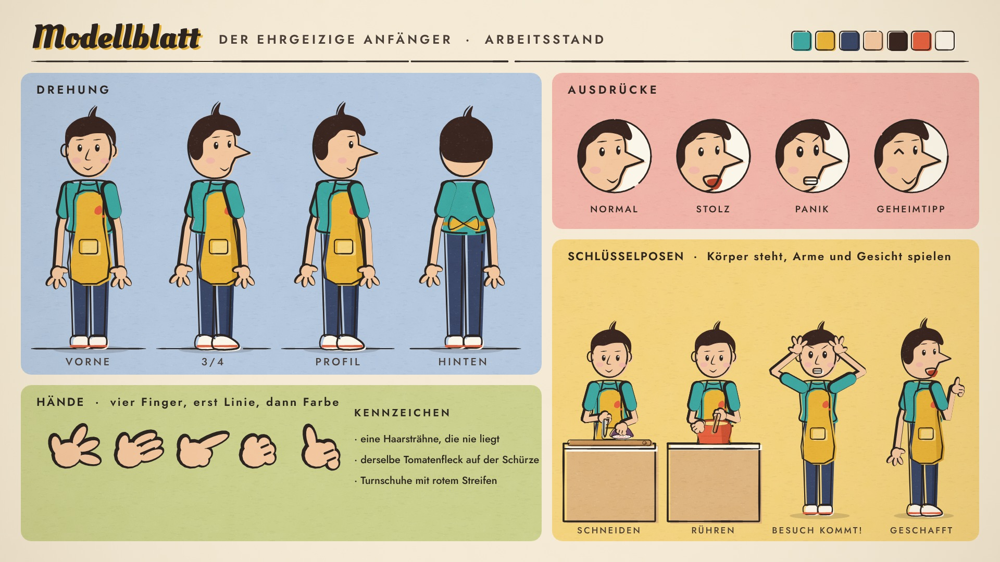
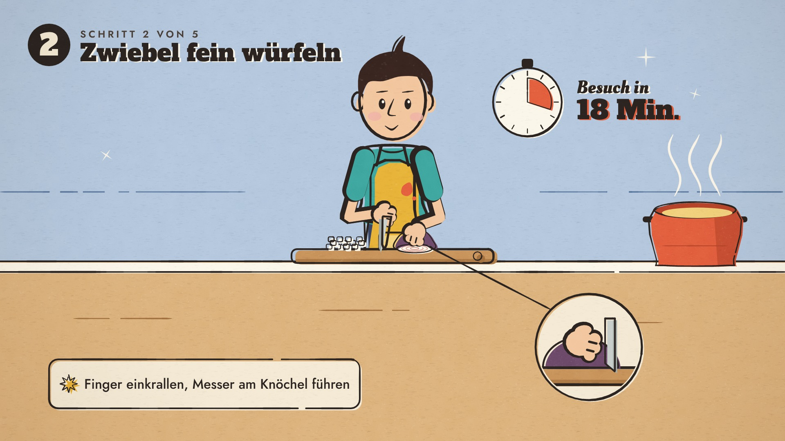

# Kochkanal: so werden Szenen gebaut

Diese Datei gilt für jede Szene, jedes Testbild und jedes Video des Kochkanals mit der Figur „der ehrgeizige Anfänger“.
Vom Kanalbetreiber (Felix) am 23.11.2026 freigegeben. **Bevor du eine Szene baust, öffne die beiden Referenzbilder unten und vergleiche dein Ergebnis am Ende damit.**

- Stil: Mid-century Cartoon (`styles/midcentury-toon/STYLE.md`). Alle Stilregeln von dort gelten zusätzlich.
- Code der Figur: [`figur/`](figur/). Für einen neuen Film den Ordner nach `films/<name>/` kopieren und dort arbeiten, `figur/` selbst nicht ändern, außer die Regeln hier ändern sich.
- Schriften laden: `sh kochkanal/figur/tools/fonts.sh` (einmal, die Dateien sind nicht in git).
- Rendern (aus dem Repo-Stamm): `node core/render/still.mjs kochkanal/figur 0 --prefix sheet_` (Modellblatt) und `… --q test=scene --prefix scene_` (Szene).

## Referenzbild 1: Modellblatt

Was das Bild festlegt:
- **Die Figur:** Anfang 20, eiförmiger Kopf, kurze dunkle Haare mit **einer Haarsträhne, die nie liegt** (sein Erkennungszeichen), türkises T-Shirt, senfgelbe Latzschürze mit Tasche und **immer demselben Tomatenfleck** links oben, dunkelblaue Hose, weiße Turnschuhe mit rotem Streifen.
- **Drehung:** vorne, 3/4, Profil, hinten. Von hinten sieht man nur die Schürzenschleife.
- **Ausdrücke, nur diese vier:** normal, stolz, Panik, Geheimtipp (Zwinkern).
- **Schlüsselposen:** Schneiden und Rühren frontal hinter der Arbeitsfläche; „Besuch kommt!“ mit beiden Händen am Kopf; „Geschafft“ mit Ellbogen am Körper und Daumen hoch vor der Brust.
- **Hände:** vier Finger (drei plus Daumen), erst Linie, dann Farbe, schlanke Finger mit Trennlinien.
- **Farben:** Türkis (Shirt), Senfgelb (Schürze), Dunkelblau (Hose), Haut, Dunkelbraun (Haare), Koralle (Akzent, Fleck, Topf), Creme.

## Referenzbild 2: Szene „Zwiebel würfeln“

Was das Bild festlegt:
- **Aufbau:** Die Figur steht **frontal hinter der Arbeitsfläche** wie ein Moderator hinter dem Tresen. Die Arbeitsfläche liegt etwa auf **Hüfthöhe** (figur-lokal y = −215). Hintergrund ist eine einfarbige Wand, kein gezeichneter Raum.
- **Arbeitshaltung:** Die **Oberarme hängen locker** am Körper, die Ellbogen sind an der Seite. Nur die **Unterarme** gehen nach vorn zum Objekt; weil sie zur Kamera zeigen, wirken sie verkürzt.
- **Hände am Objekt:** Die linke Hand (Bildseite rechts) liegt im **Krallengriff auf der Zwiebel**. Die rechte Hand (Bildseite links) hält das Messer, die Klinge zeigt **senkrecht nach unten direkt neben der Zwiebel** aufs Brett.
- **Szenario sichtbar:** Die Uhr an der Wand mit „Besuch in 18 Min.“ zeigt die Situation der Folge.
- **Schritt-Kopf** oben links (Scheibe mit Nummer, „SCHRITT 2 VON 5“, Titel), **Lupe** mit der genauen Technik in Nahaufnahme (hier: Krallengriff am Messer), **Tippkarte** unten mit einem Satz.
- **Zeichenreihenfolge:** Figur, dann Arbeitsfläche, Brett und Zutaten, dann **nur die Arme** noch einmal darüber (`armsOnly`), abgeschnitten an der Tresenkante.

## Was du niemals machen darfst

1. **Keine Hände, die neben dem Objekt schweben.** Jede Hand, die etwas berührt, wird mit `reachRelaxed()` (Arbeit am Tresen) oder `reach()` (freie Posen wie Hände am Kopf) aus `engine/chars.js` gesetzt. Niemals Armwinkel von Hand eintippen oder schätzen.
2. **Keine Pose, in der niemand freiwillig steht.** Verboten sind: Oberarme, die bei der Arbeit vom Körper abgespreizt sind; Ellbogen, die nach hinten oder oben zeigen; Arme, die quer vor dem Körper verdreht sind; Hände, die im eigenen Ellbogen kleben; Unterarme, die beim Arbeiten nach oben zeigen. `reachRelaxed()` bricht in diesen Fällen mit einem Fehler ab. **Den Fehler nie umgehen** (keine Grenzwerte lockern, kein try/catch), sondern Objekt oder Figur verschieben.
3. **Nicht im Profil oder schräg von der Seite schneiden, rühren oder arbeiten.** Im Profil lassen sich die Arme nicht natürlich zum Brett führen; das ergab verdrehte Arme. Arbeit an der Fläche ist immer frontal.
4. **Erst das Objekt, dann die Figur.** Zuerst festlegen, wo Brett, Zutat oder Topf liegen, dann die Figur so nah stellen, dass die Unterarme hinkommen. Nie umgekehrt.
5. **Jede Szene prüft ihre Hände:** `gripError()` für jede greifende Hand, höchstens 6 px Abstand zum Objekt, sonst Fehler werfen (siehe `scene.js`).
6. **Keinen Ausdruck „konzentriert“.** Er wirkte erst besorgt, dann gelangweilt. Die Figur ist immer bei der Sache; beim Arbeiten schaut sie mit dem normalen Gesicht aufs Objekt (`look` nach unten).
7. **Keinen Arm durchs Gesicht oder den Kopf ziehen**, auch nicht bei Panik oder Jubel. Hände an den Kopf heißt: seitlich an den Kopf, Ellbogen nach außen.
8. **Die Kennzeichen nicht weglassen oder verändern:** Haarsträhne, Tomatenfleck an derselben Stelle, rote Streifen an den Turnschuhen.
9. **Keine realistischen oder fotoähnlichen Bilder, keine echten Personen, keine erfundene Herkunft oder Familientradition.** Der Kanal kennzeichnet KI offen.
10. **Fertig ist eine Szene erst, wenn du sie gerendert, angesehen und mit den beiden Referenzbildern verglichen hast:** Haltung, Hände am Objekt, Kennzeichen, Ausdruck.
